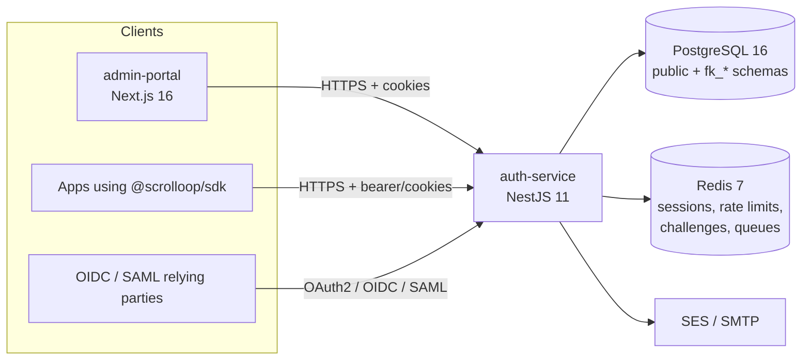

# Architecture

## System overview

## auth-service modules

| Layer | Modules |
|---|---|
| Global infrastructure | `GlobalModule` (config, cache, BullMQ, tenant middleware), `DatabaseModule`, `SharedServicesModule`, `GuardsModule`, `HealthCheckModule` |
| Identity | `auth`, `mfa`, `social-auth`, `session`, `user`, `email` |
| Authorization | `rbac` (roles, permissions, IAM policies, groups, policy evaluation) |
| Federation & protocols | `oauth` (authorize, token, introspect, revoke, discovery, JWKS), `saml`, `scim`, `ldap` |
| Platform | `tenant` (provisioning, branding, registration), `admin` (superadmin, first-run), `audit`, `webhook`, `dashboard` |

`DatabaseModule`, `SharedServicesModule` and `GuardsModule` are `@Global`: they own every
stateful cross-cutting service so that each exists exactly once per process.

## Multi-tenancy

**Schema per tenant.** Platform data (`tenants`, `key_pairs`, migrations) lives in `public`.
Each tenant's data lives in `fk_{slug}`. Provisioning (`TenantSchemaService.createSchema`)
creates the schema and every table with `CREATE TABLE … (LIKE template.<table> INCLUDING ALL)`,
under a Postgres advisory lock so concurrent pods cannot race. The `template` schema is
maintained by migrations.

**Resolution order** (`TenantResolverMiddleware`):
1. custom domain → 2. subdomain of `SENTRY_PLATFORM_DOMAIN` → 3. `X-Tenant-Slug` header →
4. `X-Tenant-ID` header (development, or `ALLOW_TENANT_ID_HEADER=true`).

**Two isolation layers.**
1. *Schema:* `TenantSchemaMiddleware` takes a QueryRunner, runs
   `SET search_path TO "fk_{slug}", public`, and stores it in `AsyncLocalStorage`. The
   `DataSource` proxy in `DatabaseModule` makes every repository use that QueryRunner.
2. *Row:* tenant tables keep `tenant_id`, and queries keep `WHERE tenant_id = …`.

`TenantBindingGuard` additionally rejects a token whose tenant differs from the request's tenant.

Routes that run without a tenant: `/health*`, `/.well-known/*`, `/superadmin/*`,
`POST /tenants/register`, `GET /tenants/slug-check`, `GET /saml/metadata/*`.

## Request lifecycle (tenant route)

1. `helmet`, cookie parser, CORS (static list + per-tenant/client origins refreshed from DB)
2. `TenantResolverMiddleware` → `req.tenant`
3. `TenantSchemaMiddleware` → tenant QueryRunner in `AsyncLocalStorage`
4. Global `RateLimitGuard` (Redis sliding window, per `@RateLimit`)
5. Route guards from `@Protected()`: `JwtAuthGuard` → `TenantBindingGuard` → `SessionGuard`
   (→ `PermissionsGuard` / `RolesGuard`)
6. `ValidationPipe` (whitelist + transform) → controller → service
7. `ResponseInterceptor` wraps JSON as `{ status, data }` (unless `@RawResponse()`)
8. On finish/close: rollback, reset `search_path`, release the QueryRunner

## Tokens and sessions

| Artifact | Format | Lifetime | Storage |
|---|---|---|---|
| Access token | RS256 JWT with `kid` | 15 min | `accessToken` httpOnly cookie (also returned in the body for SDK bearer use — see ADR-0003) |
| Refresh token | 256-bit opaque, SHA-256 hashed at rest | 30 days, rotated on use | `refreshToken` httpOnly cookie; `oauth_refresh_tokens` |
| Session | row in `fk_*.sessions` + Redis cache | `SESSION_TTL` (7 days) | Redis first, Postgres fallback |
| MFA enrollment token | HS256 JWT (`JWT_SECRET`) | 5 min | `mfa_enrollment_token` cookie, path `/mfa/enroll` |

Refresh tokens are grouped in **families**. Presenting an already-used token revokes the whole
family (stolen-token detection). Logout and password reset revoke the session in Postgres
**and** Redis and revoke refresh tokens.

## Signing keys

RSA-2048 key pairs live in `public.key_pairs`; private keys are AES-256-GCM encrypted with a key
derived from `KEYRING_MASTER_KEY`. `JwksService` (one instance, `SharedServicesModule`) loads or
creates the platform key at boot. Tokens carry `kid`; verification resolves keys by `kid`
(active or retired). JWKS is published at `/.well-known/jwks.json`.

Per-tenant keys are modelled but not yet provisioned — signing falls back to the platform key.
See remediation item P0-4.

## Authorization

Roles map to permissions (`resource:action`, wildcards allowed). IAM-style policy documents
(Allow/Deny statements with wildcards and conditions) attach to users, roles and groups;
`PolicyEvaluationService` applies explicit-deny-wins and permission boundaries. Results are
cached by the single `RbacCacheService`.

## Configuration and infrastructure

- Env contract: `apps/auth-service/src/config/env.validation.ts` (mirrored by `.env.example`).
- DB connection: `buildDataSourceOptions()` in `packages/database` — used by the runtime,
  migrations, seeders and scripts.
- Health: `GET /health` (liveness), `GET /health/ready` (Postgres + Redis, 503 when degraded).
- Background work: `@nestjs/schedule` crons (token/session cleanup), BullMQ (webhook delivery).
